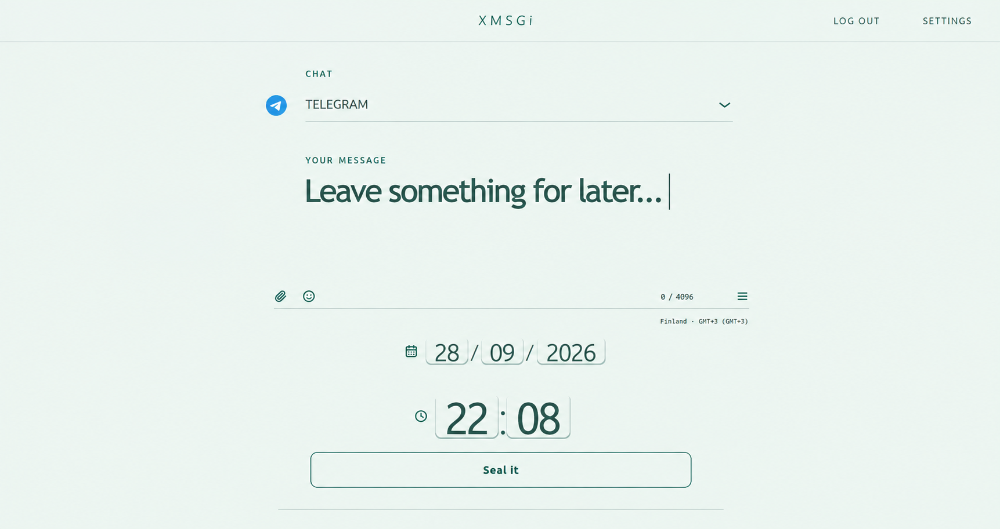

# XMSGi

**Telegram Message Scheduler** — удобное десктопное приложение для планирования и отправки сообщений в Telegram без использования ботов.



### 📁 Структура репозитория

- **`XMSGi/`** — основная папка приложения (исходный код, Electron, React, Telegram интеграция)
- `docs/` — документация по сборке и разработке
- `screenshots/` — скриншоты интерфейса
- `website/` — сайт проекта
- `.github/` — GitHub workflows

### 🚀 Быстрый старт

Перейдите в папку приложения и следуйте инструкциям:

```bash
cd XMSGi
npm install
npm run dev
```

### 📥 Скачать готовую версию

**[Перейти к релизу →](https://github.com/molodoy01/XMSGi/releases)**

Полная документация, инструкции по сборке и все детали находятся внутри папки **`XMSGi/`** — смотрите `XMSGi/README.md`.

---

**Лицензия:** MIT  
**Автор:** molodoy01
