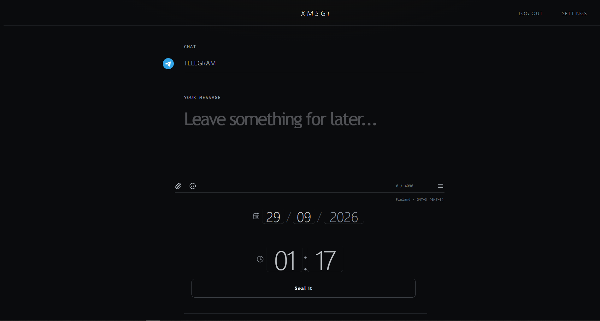
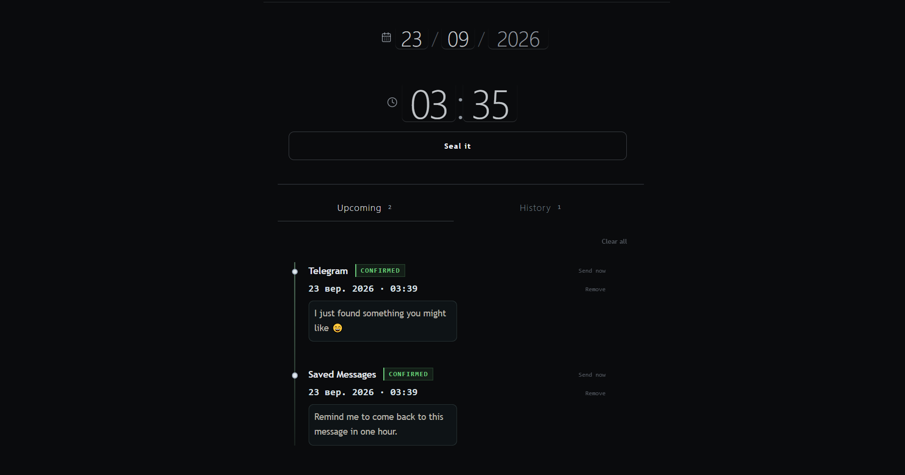
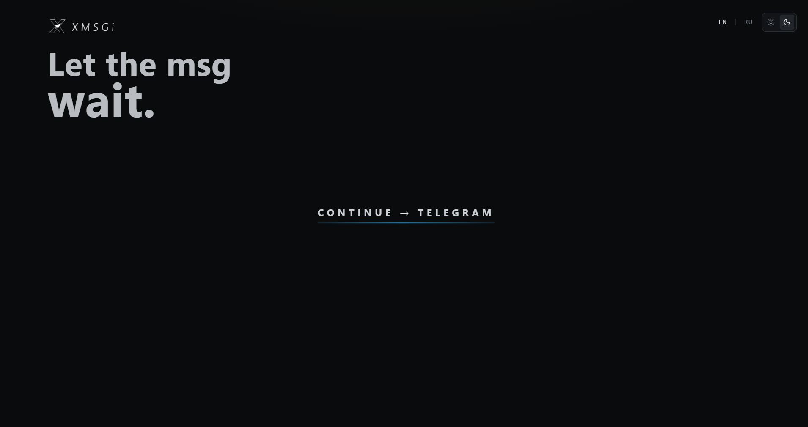

# XMSGi

**Telegram message scheduler for Windows, Linux, and macOS.**


XMSGi is a desktop application for working with Telegram messages from your personal account: write, review, schedule, and send content without requiring a Telegram bot for the main workflow.

## Overview

- Send messages immediately or schedule them for a chosen date and time.
- Manage chat and dialog selection inside the desktop workspace.
- Keep Telegram session data locally on the device.
- Use system-level secure storage where the operating system supports it.
- Publish portable release builds for Windows and package builds for Linux/macOS.

## Project status

XMSGi is currently in active desktop application development and release validation. The project is designed for practical Telegram scheduling use, with emphasis on stability, packaging quality, and local session safety.

## Features

- Telegram chat and dialog selection
- Instant and scheduled sending
- Attachment support for message composition
- Local session save and logout flows
- Forget-account cleanup for saved session data
- Cross-platform desktop distribution
- Security-aware local storage and IPC validation

## Download

**XMSGi 2.2.7** is available for Windows, Linux, and macOS.

### Windows

Portable `.exe` build — no installation required.

### Linux

AppImage and Debian `.deb` packages are available.

### macOS

DMG package for macOS users.

**[Download XMSGi 2.2.7 from GitHub Releases](https://github.com/molodoy01/XMSGi/releases/tag/v2.2.7)**

## Getting Started

### Requirements

- Node.js 18+
- npm
- Electron-compatible desktop environment for local app run

### Install

```bash
npm install
```

### Run in development mode

```bash
npm start
```

### Production build

```bash
npm run build
```

### Package Windows release

```bash
npm run dist
```

## Screenshots







## Privacy & Security

Telegram session data is stored locally and protected using Electron secure storage when available.

XMSGi does not depend on a Telegram bot for its core scheduling flow. The project also includes IPC validation and secure-config handling for local account storage.

See the dedicated [SECURITY.md](../SECURITY.md) for vulnerability reporting and security expectations.

## Quality & Coverage

The project currently covers approximately 210+ automated tests across chat, scheduler, auth, storage, and UI flows.

## Project Documentation

This repository is organized around a few purpose-specific documents:

- [README.md](../README.md) — project overview, installation, and usage
- [CONTRIBUTING.md](../CONTRIBUTING.md) — contribution workflow and PR expectations
- [CHANGELOG.md](../CHANGELOG.md) — release history and feature notes
- [SECURITY.md](../SECURITY.md) — security policy and reporting flow
- [docs/BUILDING.md](../docs/BUILDING.md) — build, test, and release workflow
- [LICENSE](../LICENSE) — project license

## Repository structure

```text
.
├── .github/          # CI/CD workflows
├── docs/             # build & release documentation
├── screenshots/      # UI screenshots
├── website/          # project website (GitHub Pages)
├── XMSGi/            # the desktop application
│   ├── src/          # React UI sources
│   ├── build/        # application icons
│   ├── main.cjs      # Electron entry point
│   ├── preload.cjs   # Electron preload script
│   ├── package.json  # app metadata & scripts
│   └── ...
├── README.md
├── CHANGELOG.md
├── SECURITY.md
├── CONTRIBUTING.md
└── LICENSE
```

## Open Source

XMSGi is open source and available on GitHub.

This project is licensed under the [MIT License](../LICENSE).
